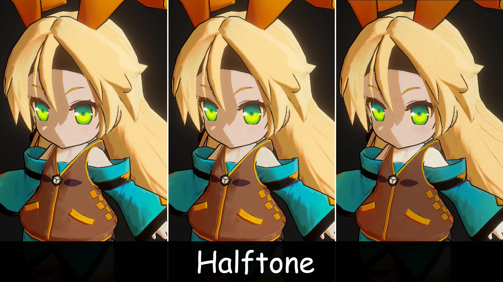
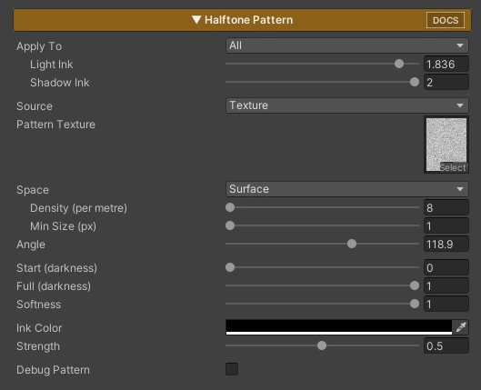

## Halftone Pattern

Draws shading as print-style ink: halftone dots, hatching lines, cross-hatch, or your own pattern texture. The darker the painted color, the bigger the dots, so shadows turn into a screen-tone look like comics and printed illustration.

*(Halftone Pattern will be added in Version 2.3.0.)*



Turn on **Halftone Pattern** in the Features grid and its section appears.

### Parameters

- **Apply To :** Where the ink can appear
    - ***Shadow* :** The shadow side, both steps when 2 Shadows is on
    - ***Second Shadow* :** Only the second shadow (needs 2 Shadows in [ToonRampShade](../ToonRampSmooth/))
    - ***All* :** The whole surface. Dark colors get ink even in the light, like a printed page
- **Light Ink / Shadow Ink / Second Shadow Ink :** Ink weight for each area *(0 = none / 1 = normal / 2 = heavier)*. Only the areas used by Apply To are shown
- **Source :** Where the dot shape comes from
    - ***Math* :** Built-in shapes, no texture
    - ***Texture* :** Your own pattern texture *(see [Custom Pattern Texture](#custom-pattern-texture))*
- **Pattern Type :** *Dots* (halftone) / *Lines* (hatching) / *Cross* (cross-hatch). Math source only
- **Pattern Texture :** The pattern tile. Texture source only
- **Space :** How the pattern is placed
    - ***Surface* :** Stuck to the character, moves with it, no UV seams
    - ***Screen* :** Flat on the screen like a printed page, sized by how big the character appears. Can shimmer while the character moves
- **Density (per metre) :** Surface only. Dots per metre on the character *(higher = smaller dots)*
- **Screen Cells / Reference Distance / Distance Scaling :** Screen only. Dot count per screen height at the Reference Distance, and how much dot size follows camera distance *(0 = fixed on screen / 1 = follows fully)*
- **Min Size (px) :** When dots get smaller than this on screen, they blend into a flat tone of the same darkness instead of turning into noise
- **Angle :** Rotation of the pattern
- **Start / Full (darkness) :** How dark a color must be before ink starts, and where cells are fully inked. Lower Full = heavier ink overall
- **Softness :** Edge blur of each dot or line *(0 = crisp)*
- **Ink Color :** Color of the dots or lines
- **Strength :** Blend of the ink over the shaded color *(1 = solid ink)*
- **Debug Pattern :** Shows the pattern alone, white on black, for tuning size and range

### How Ink Amount Works

Ink follows the darkness of the **painted color** (texture × Shadow Color or Base Color). Light intensity does not change it, so a pale material stays light and a dark one gets heavier ink. Switching Apply To only changes where ink can appear, not how much.

### Custom Pattern Texture

Any tileable grey image works as a pattern. Dark pixels get ink first, light pixels last, so the dots grow from dark to light as the color gets darker.

- Starter tiles are in **ZLZ / Common / Textures / Pattern** *(Dot, Line, Cross, Diamond, Rough Dot, Stipple, Sketch Hatch, Grain)*
- Import settings: **sRGB off**, **Wrap Mode Repeat**, **Compression None**
- Grey values spread evenly from black to white give the most accurate darkness

### Tips

- If dots look too dense or too sparse, change **Density** (Surface) or **Screen Cells** (Screen)
- If shadows look too dark or too light, adjust **Full (darkness)** or the **Ink** sliders
- If far away characters show noise, raise **Min Size**
- If the ink looks too harsh, lower **Strength** or use a darker version of Shadow Color as **Ink Color**

### Performance

Math source uses only arithmetic, no texture. Texture source adds 3 texture samples per pixel in Surface space, 1 in Screen space.

---
