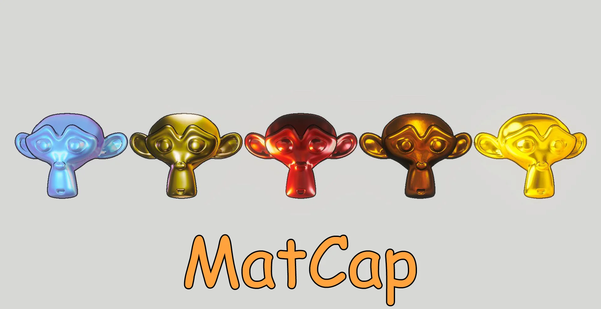

## MatCap

Adds a material look from a single sphere texture. Metal, gold, glossy plastic or leather can be painted into the sphere and put on any part of the character, no reflection probe or extra light needed. The MatCap follows the camera, not the light, so the shine stays in place when the character turns.

*(MatCap will be added in Version 2.7.0.)*



Turn on **MatCap** in the Features grid and its section appears.

The area is controlled by the [Feature Mask](../#mask-layout-update-in-v-150) *(default : Mask 2, Green Channel)*. Uncheck **Use Mask** to apply it to the whole mesh.

### Parameters

- **MatCap Texture :** The sphere texture with the material look
- **Blend :** How the MatCap is mixed with the shaded color
    - ***Add* :** Brightens the surface. Good for metal shine and glossy highlights
    - ***Multiply* :** Tints and darkens the surface. Good for leather, cloth depth and soft shading
- **Color (HDR) :** Tints the MatCap
- **Hue :** Rotates the colors of the MatCap after Color, so one texture can give several color variants *(0 = unchanged)*
- **Intensity :** Add = brightness of the MatCap. Multiply = full strength at 1
- **Shadow Fade :** Add only. *0* = same in light and shadow / *1* = lit side only

### MatCap Texture

- Starter textures are in **ZLZ / AnimeShader / Textures / MatCap** *(T_MatCap_001 – 005)*
- Import settings: **Wrap Mode Clamp**
- Open **ZLZ_Demo_MatCap** scene to see example materials

### Tips

- One gold texture + **Hue** can make silver, copper or colored metal without new textures
- If the MatCap looks too bright in shadow, raise **Shadow Fade**
- Use **Multiply** with a dark sphere for leather or matte parts, **Add** for metal and accessories

### Performance

1 texture sample. The mask is shared with the Feature Mask, so no extra sample.

---
