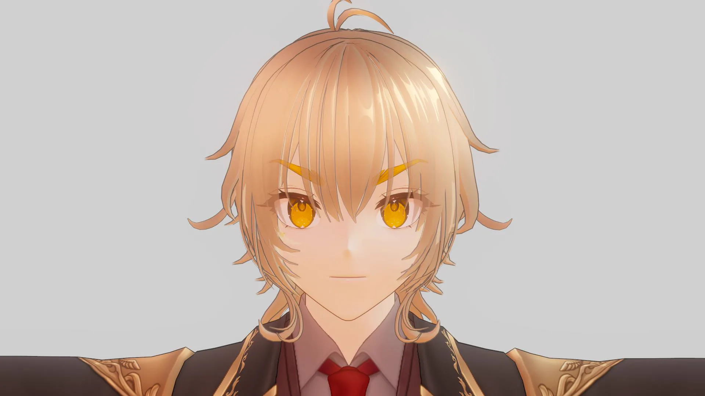
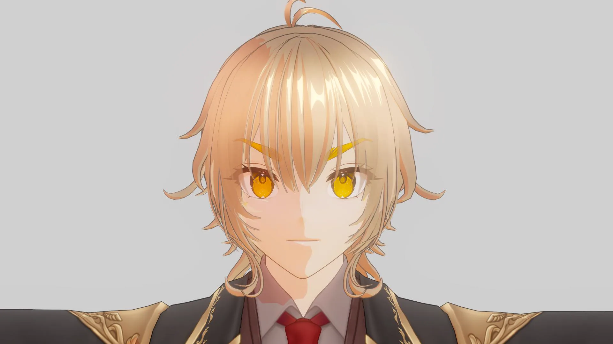
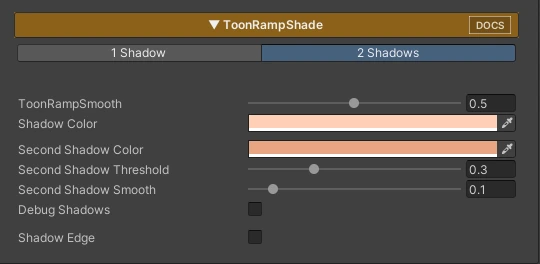

## ToonRampShade

  

    
  

  

    
  

  

  
ToonRampSmooth : 1

  
ToonRampSmooth : 0

Controls how light turns into shadow: how sharp the edge is, the shadow color, and whether the shadow side has one tone or two.

### Shadow Steps

- ***1 Shadow* :** Light and shadow, the classic cel look
- ***2 Shadows* :** Adds a second, deeper shadow where the surface turns further from the light, for more volume

### Parameters

- **ToonRampSmooth :** Softness of the light/shadow edge *(0 = hard cel edge / higher = smoother)*
- **Shadow Color :** Color of the shadow side

**2 Shadows only**

- **Second Shadow Color :** Color of the second shadow, used exactly as set (not mixed with Shadow Color)
- **Second Shadow Threshold :** How far the surface must turn from the light before the second shadow starts *(0 = right after the light edge / higher = only the far side)*
- **Second Shadow Smooth :** Softness of the edge between the two shadows
- **Debug Shadows :** Shows light / shadow / second shadow as flat greys, useful while tuning the Threshold
- **Shadow Edge :** Darker band along the light/shadow boundary. See [Shadow Edge](../ShadowEdge/)

### Second Shadow on the Face

On [Face Shadow](../faceshadow/) materials the second shadow comes from the Face Texture, so its shape is hand-drawn like the first:

- **R / G :** First shadow *(G = R mirrored)*
- **B / A :** Second shadow *(A = B mirrored)*

If you enable the Face Shadow Property feature, the Second Shadow adjustment will be hidden.

### Tips

- If the second shadow covers too much, raise **Second Shadow Threshold**
- If the two steps look like one, give **Second Shadow Color** more contrast against Shadow Color
- If the step edges flicker at a distance, raise **ToonRampSmooth** or **Second Shadow Smooth** slightly

### Performance

2 Shadows costs a few arithmetic operations per pixel and no extra texture sample.

---
